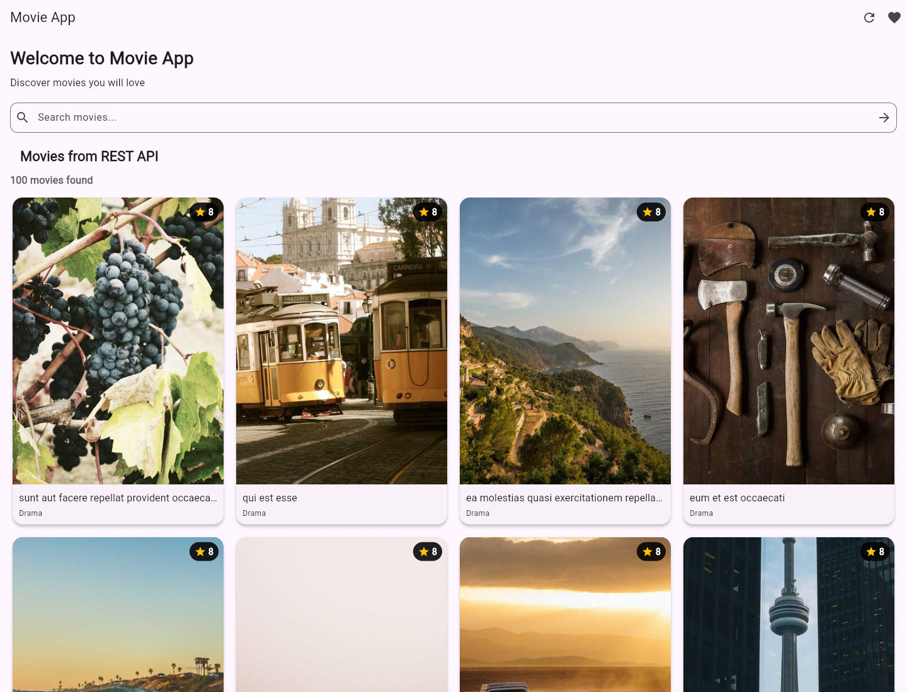
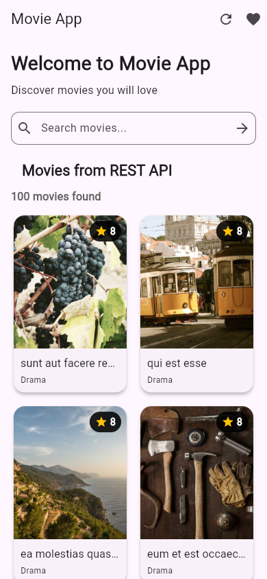
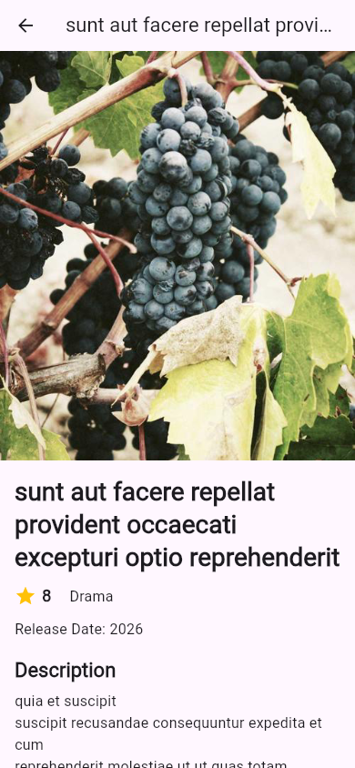

# Movie App – Flutter Lab Project

**Course:** CS506PC – UI Design (Flutter Lab)  
**Project:** Movie App  
**Technology:** Flutter, Dart

## 1. Project Description

Movie App is a Flutter application for browsing movie information. The project demonstrates movie listing, search, responsive layouts, navigation, reusable widgets, Provider-based state management, REST API integration, animations, and tests.

## 2. Features

- Movie listing loaded from a REST API
- Movie search and clear-search functionality
- Movie details screen and named-route navigation
- Favorites screen and Provider-based favorite state
- Responsive movie grid using LayoutBuilder
- Reusable widgets and shared theme styling
- Fade-in and slide-in animations
- Loading, error, and empty states
- Unit and widget tests

## 3. Lab Experiments with Project Screenshots

Each experiment includes a screenshot captured from the compiled, running Movie App. The images are placed directly under the experiment they demonstrate, rather than collected in a separate gallery.

### Experiment 1 – Flutter and Dart Basics

Flutter app entry point, Dart classes, imports, and application structure.



### Experiment 2 – Flutter Widgets and Layouts

Movie listing showing the project's cards, text, images, icons, and layout widgets.


### Experiment 3 – Responsive UI Design

The actual app rendered at a phone-sized viewport to demonstrate the responsive movie grid.



### Experiment 4 – Navigation

The movie details screen opened from a movie card in the running app.



### Experiment 5 – State Management

The favorites screen rendered through the Provider-managed favorites state.


### Experiment 6 – Custom Widgets and Themes

The running movie listing using reusable movie cards, rating badges, section titles, and the app theme.


### Experiment 7 – Forms and Validation

The actual search form after entering a movie query and applying the filter.


### Experiment 8 – Animations

The movie listing after the fade-in and slide-in animations have rendered.


### Experiment 9 – REST API and JSON

The movie listing after the REST API request and JSON-to-model mapping have completed.


### Experiment 10 – Testing and Debugging

The app screenshot captured after the workflow passes Flutter analysis and automated tests.


## 4. Automatic Screenshot Capture

GitHub Actions workflow: `.github/workflows/capture-screenshots.yml`

- Runs Flutter analysis and automated tests before building the web app.
- Launches the compiled Movie App in Chromium and captures a screenshot for each of the 10 experiments.
- Commits the PNG files into `screenshots/` so they render inline above.
- Uploads the screenshots as a downloadable Actions artifact.
- Can also be started manually from **Actions → Capture Movie App Screenshots → Run workflow**.

## 5. How to Run the Project

Install Flutter, then run:

```bash
git clone https://github.com/manichandanreddy1775/movie_app.git
cd movie_app
flutter pub get
flutter run -d chrome
```

Run checks:

```bash
flutter analyze
flutter test
```

## 6. Project Structure

```text
lib/
  data/
  models/
  providers/
  screens/
  services/
  theme/
  widgets/
test/
screenshots/
.github/
  scripts/
  workflows/
```

## 7. GitHub Repository

[Movie App Repository](https://github.com/manichandanreddy1775/movie_app)

## 8. Conclusion

This project applies Flutter UI design concepts in a movie browsing application. The source files, tests, and screenshots provide evidence of the implemented lab experiments.
