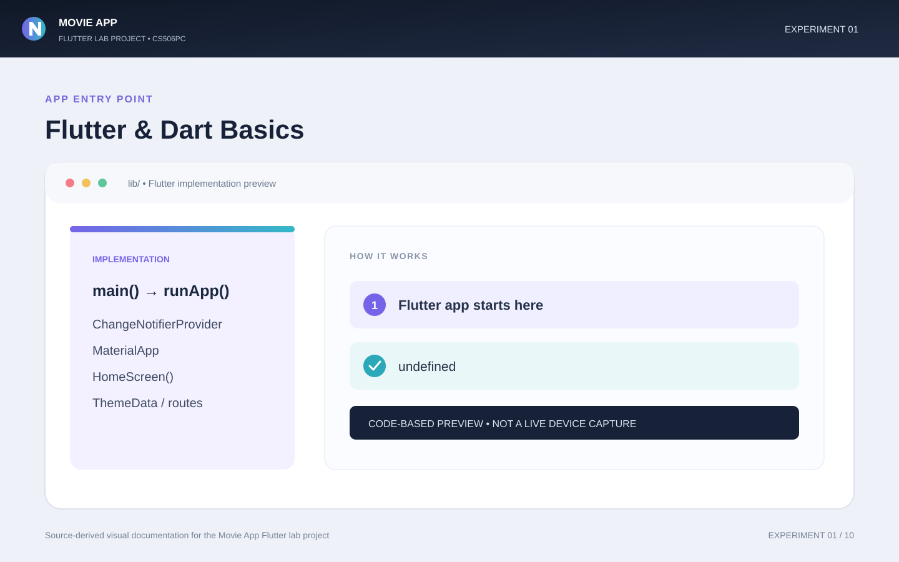
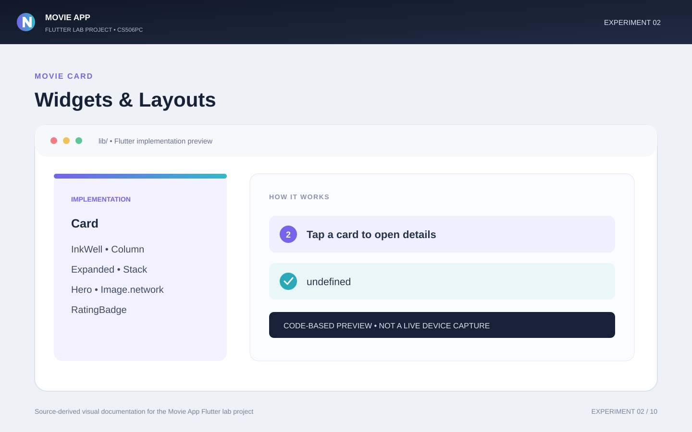
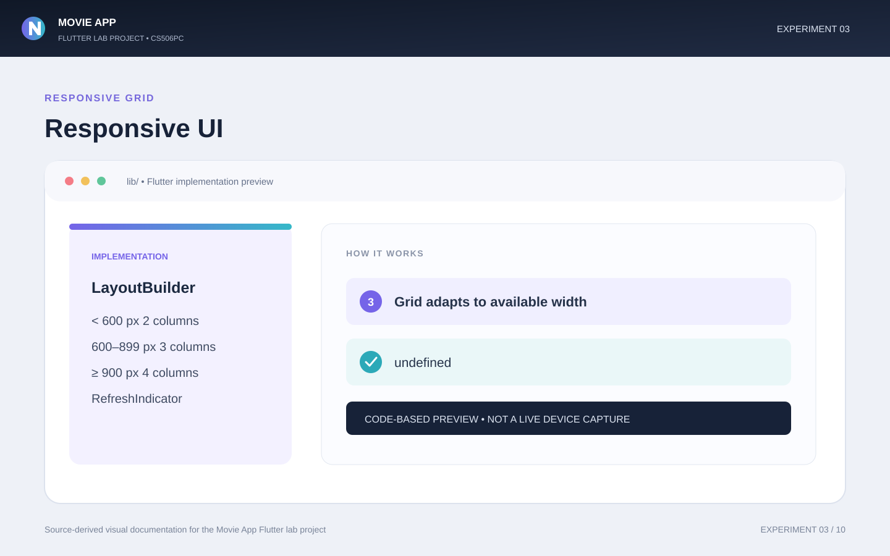
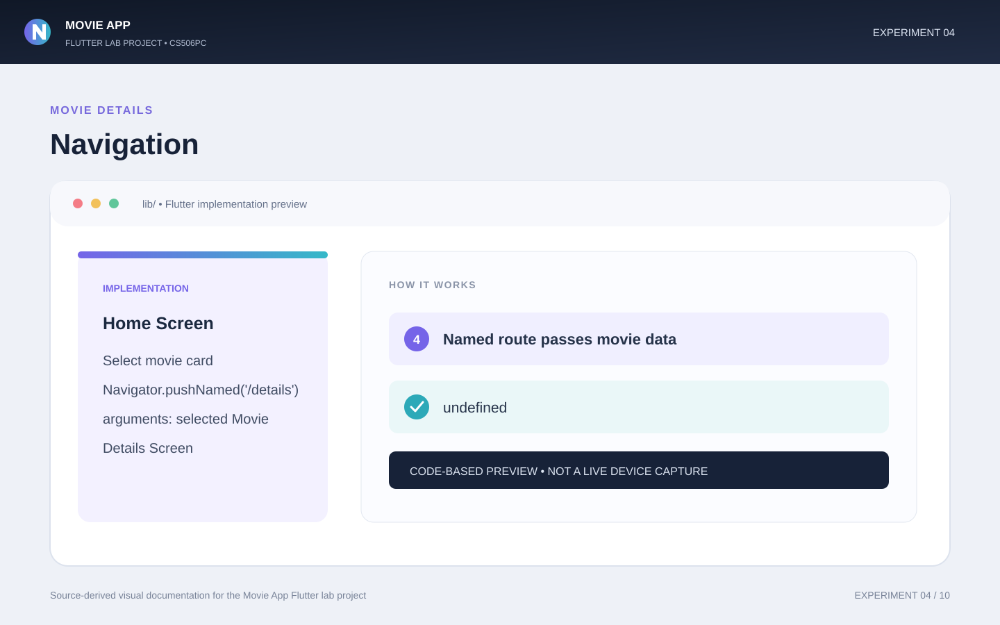
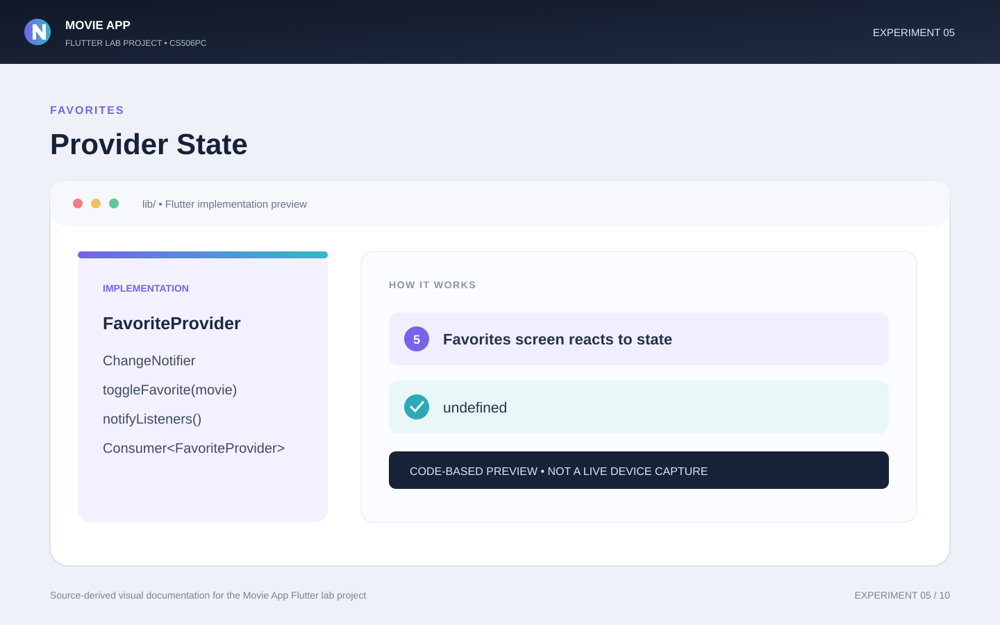
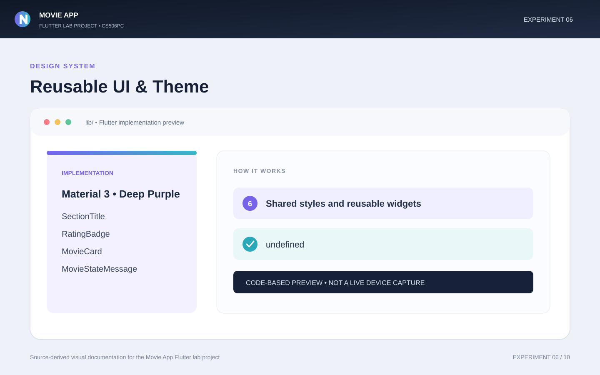
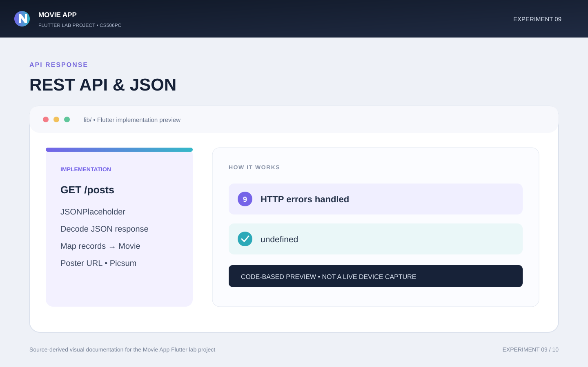
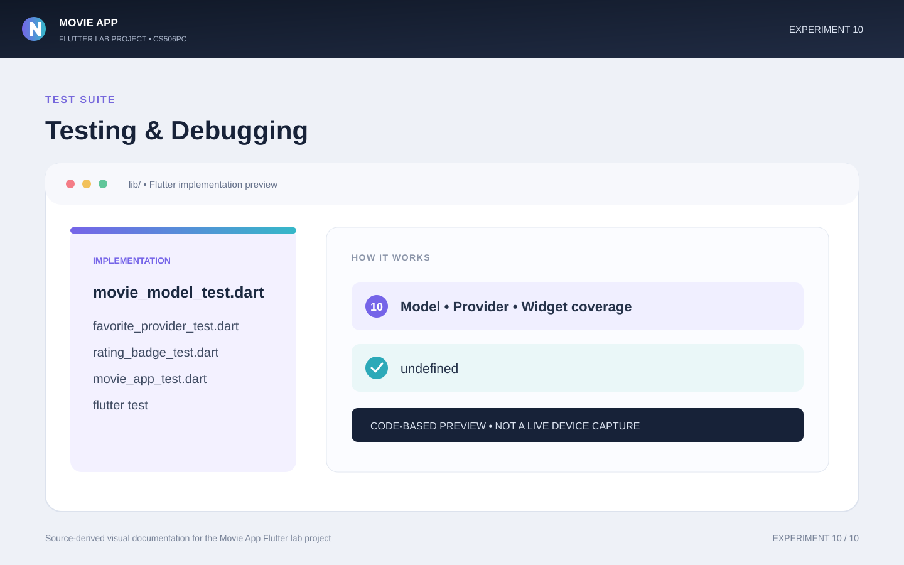

# Movie App – Flutter Lab Project

**Course:** CS506PC – UI Design (Flutter Lab)  
**Project:** Movie App  
**Technology:** Flutter, Dart

## 1. Project Description

Movie App is a Flutter application for browsing movie information. The project demonstrates movie listing, search, favorites, navigation, reusable widgets, responsive layouts, animations, REST API integration, and testing.

## 2. Features

- Movie listing and details
- Search and clear-search functionality
- Favorites management
- Responsive movie grid
- Reusable widgets and theme styling
- Form validation and animations
- REST API and JSON integration
- Loading, error, and empty states
- Unit and widget tests

## 3. Lab Experiment Mapping

### Experiment 1 – Flutter and Dart Basics
Flutter app structure, Dart classes, imports, and application entry point.

### Experiment 2 – Flutter Widgets and Layouts
Text, Image, Container, Icon, Row, Column, Stack, Card, and buttons.

### Experiment 3 – Responsive UI Design
Responsive layouts and grid columns based on available screen width.

### Experiment 4 – Navigation
Navigation between movie listing, movie details, and favorites.

### Experiment 5 – State Management
Provider, ChangeNotifier, and favorite state updates.

### Experiment 6 – Custom Widgets and Themes
Reusable components and shared application styling.

### Experiment 7 – Forms and Validation
Movie search form and input validation.

### Experiment 8 – Animations
Fade-in, slide-in, and hover animation concepts.

### Experiment 9 – REST API and JSON
HTTP requests, JSON parsing, and mapping API data to model objects.

### Experiment 10 – Testing and Debugging
Unit and widget test coverage.

## 4. Experiment Visual Previews

The following images are visual documentation previews based on the project concepts. They are not screenshots captured from a running emulator or browser.

### Experiment 1 – Flutter and Dart Basics


### Experiment 2 – Flutter Widgets and Layouts


### Experiment 3 – Responsive UI Design


### Experiment 4 – Navigation


### Experiment 5 – State Management


### Experiment 6 – Custom Widgets and Themes


### Experiment 7 – Forms and Validation


### Experiment 8 – Animations


### Experiment 9 – REST API and JSON


### Experiment 10 – Testing and Debugging


## 5. How to Run the Project

Install Flutter, then run:

```bash
git clone https://github.com/manichandanreddy1775/movie_app.git
cd movie_app
flutter pub get
flutter run
```

Run checks:

```bash
flutter analyze
flutter test
```

## 6. Project Structure

```text
lib/
  data/
  models/
  providers/
  screens/
  services/
  theme/
  widgets/
test/
screenshots/
```

## 7. GitHub Repository

[Movie App Repository](https://github.com/manichandanreddy1775/movie_app)

## 8. Conclusion

This project demonstrates Flutter UI design and application development concepts through a movie browsing application. The experiment previews are provided above for quick reference.
